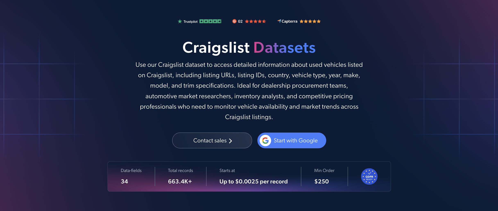

# Craigslist-dataset-samples

<h2>A sample dataset of 1000 Craigslist car and truck listings</h2>

<a href="https://brightdata.com/products/datasets/craigslist">
   
</a>

A Craigslist dataset sample of 1000 used car and truck listings. Dataset was extracted using the <b>Bright Data API</b>.

<h2>Some of the data points that are included in the dataset:</h2>

* ```url```: URL of the Craigslist listing
* ```listing_id```: Unique Craigslist post ID
* ```type```: Vehicle type, such as sedan, SUV or pickup
* ```year```: Year of manufacture
* ```make```: Brand or manufacturer of the vehicle
* ```model```: Model of the vehicle
* ```trim```: Version or configuration of the model
* ```price```: Listed price of the vehicle
* ```currency```: Currency of the price
* ```mileage```: Mileage of the vehicle
* ```condition```: Condition of the vehicle
* ```title_status```: Title status, such as clean or salvage
* ```vin```: 17-character Vehicle Identification Number
* ```engine```: Engine type and details
* ```cylinders```: Number of cylinders
* ```fuel```: Fuel type
* ```transmission```: Transmission type
* ```drivetrain```: Drivetrain type
* ```paint_color```: Paint color of the vehicle
* ```description```: Description of the vehicle from the listing
* ```city```: City of the listing
* ```state```: State of the listing
* ```posted_at```: Date and time the listing was posted
* ```images```: URLs of vehicle photos

And a lot more.

This is a sample subset which is derived from the "Craigslist Cars & Trucks Listings (public data)"
dataset which includes more than <b>663,000 listings</b>.

Available dataset file formats: <b>JSON, NDJSON, JSON Lines, CSV, XLSX, or Parquet. Optionally, files can be compressed to .gz</b>.

Dataset delivery type options: <b>Email, API download, Webhook, Amazon S3, Google Cloud storage, Google Cloud PubSub, Microsoft Azure, Snowflake, SFTP</b>.

Update frequency: <b>Once, Daily, Weekly, Monthly, Quarterly, Biannual, or Custom basis</b>.

Data enrichment available as an addition to the data points extracted: <b>Based on request.</b>

<b>[Get the full Craigslist dataset](https://brightdata.com/products/datasets/craigslist)</b>.

<a href="https://brightdata.com/products/datasets/craigslist">
</a>

<h2>What are the Craigslist datasets use cases?</h2>

<h3>1. Used vehicle pricing analysis</h3>
Dealerships and analysts use Craigslist datasets to compare listed prices against year, mileage and condition across hundreds of thousands of ads. This helps build depreciation curves and shows what comparable vehicles actually ask in each market. Title status and drivetrain details make it easy to separate retail-ready cars from salvage and project vehicles before modeling prices.

<h3>2. Regional market comparison</h3>
Craigslist is organized by metro area, so listings can be compared by city and state. Comparing prices by location shows where a model sells at a premium and where inventory sits unsold, helping buyers and dealers decide where to source and sell vehicles.

<h3>3. Inventory and supply tracking</h3>
Automotive researchers track which makes and models appear by posting date to measure how much used supply enters each market week by week. This reveals shifts in availability and helps procurement teams plan purchasing ahead of market changes.

<h2>Free access to web scraping tools and datasets for academic researchers and NGOs</h2>

The Bright Initiative offers access to Bright Data's <b>[Web Scraper APIs](https://brightdata.com/products/web-scraper)</b> and <b>[ready-to-use datasets](https://brightdata.com/products/datasets)</b> to leading academic faculties and researchers, NGOs and NPOs promoting various environmental and social causes. You can submit an application <b>[here](https://brightinitiative.com)</b>.
